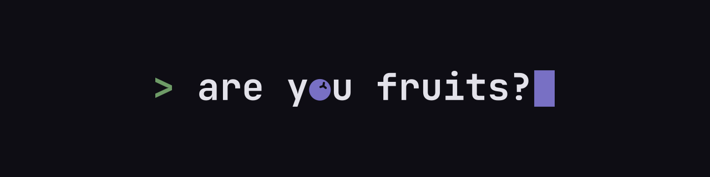

<picture>
  <source media="(prefers-color-scheme: dark)" srcset="https://raw.githubusercontent.com/are-you-fruits-studio/.github/main/profile/brand/github/readme-banner-dark-1280x320.png">
  <source media="(prefers-color-scheme: light)" srcset="https://raw.githubusercontent.com/are-you-fruits-studio/.github/main/profile/brand/github/readme-banner-light-1280x320.png">
  
</picture>

**We make games and the engine we make them with.**

**are you fruits?** is a small independent game studio. Our games are not public yet. Our engine, Aphyn, is open source.

## Games

Nothing to show publicly yet. Follow this organization to see the first announcement.

## Aphyn

A game engine written in Rust. We started it in May 2024 under the in-house name Fruits Engine, and it grows from what our own games need. Open source under MIT OR Apache-2.0: read it, run it, build on it.

- [`aphyn`](https://github.com/are-you-fruits-studio/aphyn): the engine. Crates, examples, the `aphyn` CLI, docs source.
- [`aphyn.org`](https://github.com/are-you-fruits-studio/aphyn.org): the [aphyn.org](https://aphyn.org) landing page.
- Docs: [docs.aphyn.org](https://docs.aphyn.org)

> [!NOTE]
> Aphyn is in early development and its API will change. See the [status](https://github.com/are-you-fruits-studio/aphyn#status).

## Contributing

- Found a bug in Aphyn? [Open an issue](https://github.com/are-you-fruits-studio/aphyn/issues).
- External pull requests are not accepted for now. See [`CONTRIBUTING.md`](https://github.com/are-you-fruits-studio/aphyn/blob/HEAD/CONTRIBUTING.md).

## Brand

Our name is a question, so our logo is a question typed into a terminal. The **o** in *you* is the Aphyn berry: the studio and its engine in one line.

Logo, mark, icons and GitHub assets live in [`profile/brand`](https://github.com/are-you-fruits-studio/.github/tree/main/profile/brand).
