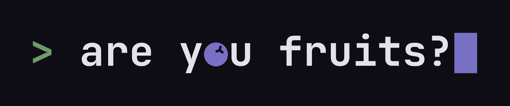

# are you fruits? — brand assets

The primary studio logo, adopted on 13 Nov 2026: `> are you fruits?▍`, typed in JetBrains Mono Bold, with the Aphyn berry in place of the **o** and a cursor block at the end. The mark `>●` is the prompt and the berry alone.

  
  

## Folders

| Folder | What is in it |
|---|---|
| [`logo/`](logo) | Wordmark and mark. `-dark` / `-light` for dark / light grounds, `-bg` versions carry their own ground, `white` / `black` are one colour. SVGs are outlined: no font needed. |
| [`icons/`](icons) | App and web icons from the mark on `ground`: `icon-16` … `icon-1024`, `apple-touch-icon-180`, `favicon.svg`, `icon-rounded.svg` (22% tile), `icon-square.svg`, `icon-small.svg` (master for 16 and 32 px). Small sizes drop the calyx cut so the berry stays a clean dot. The PNG sizes are rendered from these SVGs. |
| [`github/`](github) | Org avatar (500, 1024; PNG only), repository social preview 1280 × 640, README banners for dark and light themes (1280 × 320). Banners and the social preview have SVG masters. |

## Using the logo

- **Clear space:** one mono cell (0.6 em of the logo's type size) on every side.
- **Minimum size:** wordmark 160 px wide; below that use the mark (24 px minimum). Below 32 px use `favicon.svg`, `icon-16.png` or `icon-32.png`.
- **Don't:** set the name in another typeface, round the cursor, recolour the berry, drop the `>`, add a second berry, stretch, outline or add effects.

## Colour

| Token | Dark | Light | Used for |
|---|---|---|---|
| `ground` | `#0E0D14` | `#FAF9FC` | Background behind the logo |
| `ink` | `#E3E2EA` | `#241F52` | Logo letters, primary text |
| `prompt` | `#6E9B67` | `#3E6139` | The `>` prompt |
| `berry` | `#7870C4` | `#3B3486` | The berry and the cursor block |
| `muted` | `#9C9BB0` | `#535268` | Taglines and captions |

## Type

JetBrains Mono Bold for the logo and display lines; Onest for body text. Both are on Google Fonts under the SIL Open Font License 1.1.
